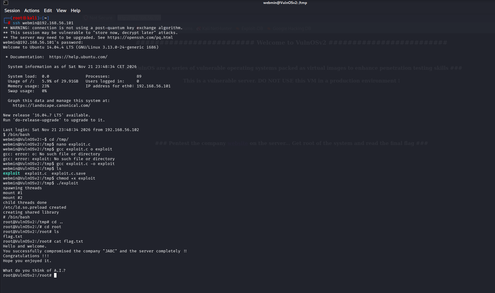

# VulnOS 2 — Technical Walkthrough

[← Lab overview](README.md) · [← Main repository](../README.md) · [All 30 screenshots](evidence.md)

> **Scope:** This is a completed educational penetration-testing challenge against a personally controlled, intentionally vulnerable VM on an isolated VirtualBox Host-Only network. Commands and results are included for lab reproducibility; they are not permission to test other systems.

## 1. Objective, setup, and outcome

The goal was to identify the VulnOS 2 target, investigate its public-facing services and web applications, obtain authorized training-lab access, escalate privileges, and read the final root flag.

| Setting | Observed value |
| :-- | :-- |
| Host operating system | Windows 11 |
| Virtualization | Oracle VirtualBox (Type 2 hypervisor) |
| Attacker machine | Kali Linux (`192.168.56.102`) |
| Victim | VulnOS 2 (`192.168.56.101`) |
| Lab network | Host-Only `192.168.56.0/24` |
| Target operating system | Ubuntu 14.04.4 LTS observed on SSH login |
| Kernel | `3.13.0-24-generic` |
| Completed objective | SSH login → root shell → `/root/flag.txt` |

**Result:** **Complete.** The final screenshot confirms the root shell and displayed challenge message. The outcome is distinct from what earlier individual scans could prove.

## 2. Network configuration and host discovery

The first Kali screenshot showed the default VirtualBox NAT address `10.0.2.15`. For safe, direct VM-to-VM access, both Kali and VulnOS 2 were moved to the same **Host-Only** network. Kali was then assigned `192.168.56.102/24` on `eth0`.

```bash
ip a
```

An initial Nmap discovery command caused an assertion in the DNS resolver. Re-running with DNS resolution disabled worked:

```bash
nmap -sn -n 192.168.56.0/24
```

**Observed:** 256 addresses inspected, four active hosts at `192.168.56.1`, `.100`, `.101`, and `.102`. The presence of a responding host alone did not prove which one was the victim.

To distinguish candidates, I checked a small set of common TCP ports:

```bash
nmap -n -p 21,22,80,443,8080 192.168.56.100 192.168.56.101
```

All five tested ports on `.100` were closed. On `.101`, ports `22` and `80` were open. Later, the VulnOS welcome page verified the host identity.

**Evidence:** [01–03 — network configuration and discovery](evidence.md#phase-a--network-and-reconnaissance-01104)

## 3. Service enumeration

```bash
nmap -n -sV 192.168.56.101
```

The default top-1,000 TCP port scan identified:

| TCP port | State | Observed service |
| :-- | :-- | :-- |
| `22` | Open | OpenSSH 6.6.1p1 Ubuntu 2ubuntu2.6 |
| `80` | Open | Apache httpd 2.4.7 (Ubuntu) |
| `6667` | Open | ngIRCd (IRC) |

The other **997 scanned ports were closed**; this was **not** an all-65,535-port scan. Software banners provide leads for vulnerability research, not proof of a vulnerability by themselves.

**Evidence:** [04 — service versions](evidence.md#phase-a--network-and-reconnaissance-01104)

## 4. Drupal website enumeration

The browser at `http://192.168.56.101/` displayed the VulnOS 2 challenge welcome page and linked to the JABC site at `/jabc/`. The initial website was a company-branded Drupal application.

### 4.1 Fingerprinting

```bash
curl -I --max-time 10 http://192.168.56.101/jabc/
whatweb http://192.168.56.101/jabc/
```

**Observed:** `HTTP/1.1 200 OK`, `X-Generator: Drupal 7`, Apache 2.4.7, PHP 5.5.9-1ubuntu4.14, and jQuery. WhatWeb initially caused a freeze in the Kali VM, but a later run succeeded. **Drupal 7 was identified, not its exact point release.**

### 4.2 Testing public metadata

```bash
curl -sS --max-time 10 http://192.168.56.101/jabc/CHANGELOG.txt | head -n 20
curl -sS --max-time 10 http://192.168.56.101/CHANGELOG.txt | head -n 20
curl -sS --max-time 10 http://192.168.56.101/jabc/robots.txt
```

Both `CHANGELOG.txt` locations returned **404 Not Found**. The `/jabc/robots.txt` file listed common Drupal crawler exclusions such as `/includes/`, `/modules/`, `/admin/`, and `/user/login/`. Those lines are **hints to crawlers**, not proof that the resources exist or are vulnerable.

### 4.3 Website navigation

The Drupal user login form was accessible with the `?q=user/login` routing convention. The registration form requested username and email; successful account creation was not tested. The JABS section linked to three product nodes:

| Page | Drupal route | Observation |
| :-- | :-- | :-- |
| JABS | `?q=node/3` | Product list |
| MODEL-101 | `?q=node/4` | Product page, Add to cart |
| MODEL-202 | `?q=node/5` | Product page, Add to cart |
| MODEL-404 | `?q=node/6` | Product page, Add to cart |
| Documentation | `?q=node/7` | Heading visible, content visually blank |

The Add to cart control was observed, but no vulnerability was established through that interaction. The pages were useful for mapping the application, not for claiming a flaw.

### 4.4 Key clue hidden in plain sight

Although the Documentation page (`?q=node/7`) looked empty, **View Page Source** exposed black text on a black background. The HTML mentioned another application path, `/jabcd0cs/`, along with guest/demo credentials.

This was an important **information-exposure finding**: HTML styled to be hard to see is still delivered to the browser and can be read by users. The clue directed the next phase of the lab.

**Evidence:** [05–19 — Drupal, pages, and hidden source clue](evidence.md#phase-b--drupal-and-website-exploration-05119)

## 5. Discovering OpenDocMan and researching the vulnerability

Opening `http://192.168.56.101/jabcd0cs/` revealed an **OpenDocMan** login page. The footer displayed **v1.2.7**.

A local Exploit-DB search showed historical advisories associated with this product:

```bash
searchsploit OpenDocMan
```

The published **CVE-2014-1945** describes SQL injection through the `add_value` HTTP GET parameter used by OpenDocMan's `ajax_udf.php` endpoint (affected releases before 1.2.7.2). The version was a research lead; **the SQLmap output and actual record retrieval were the evidence of exploitation**.

A browser request to the endpoint in the isolated lab revealed a database-related form:

```text
http://192.168.56.101/jabcd0cs/ajax_udf.php?q=1&add_value=odm_user
```

**Evidence:** [20–23 — app/version and advisory](evidence.md#phase-c--opendocman-and-sql-injection-20125)

## 6. SQL injection validation and data extraction

The recorded command was:

```bash
sqlmap -u 'http://192.168.56.101/jabcd0cs/ajax_udf.php?q=1&add_value=odm_user' \
  --crawl=3 --risk=2 --level=3 --tamper=space2comment \
  -D jabcd0cs -T odm_user --dump --batch
```

The tool reported injection points for **`add_value` (GET)**, including boolean-based and time-based blind techniques. It **resumed stored results from a prior SQLmap session**—a detail that matters when describing whether the injection test was performed from scratch in this run.

Subsequently, the output showed a successful read of **two rows** from the database `jabcd0cs`, table `odm_user`. The extracted fields included usernames, email addresses, and password hashes.

| Observation | Finding |
| :-- | :-- |
| Parameter | `add_value` (GET) |
| Application | OpenDocMan 1.2.7 |
| Database/table | `jabcd0cs.odm_user` |
| Technique shown | Boolean-based blind and time-based blind SQLi |
| Data recovered | Two account records, including password hashes |
| Impact verified | Unauthorized database read through a web parameter |

**Important:** `--dump` retrieves data; this was performed only on the intentionally vulnerable VM. The included original screenshot of the dumped table displays lab account information. The report itself avoids reproducing those values.

**Evidence:** [24–25 — SQLmap and database extraction](evidence.md#phase-c--opendocman-and-sql-injection-20125)

## 7. Hash analysis and password-recovery outcome

A hash-identification utility suggested that the exposed 32-character hex digest could be **MD5**. Because hex length alone is not unique to MD5, this was initially a format hypothesis.

### 7.1 Dictionary attempt with John the Ripper

```bash
john --format=raw-md5 --wordlist=/usr/share/wordlists/rockyou.txt crack.txt
john --show --format=raw-md5 crack.txt
```

**Observed outcome: 0 password hashes cracked.** The RockYou-based local dictionary run did **not** recover the password. This unsuccessful attempt remains part of the evidence.

### 7.2 Known-hash database lookup

A separate lookup using the training password hash returned a matching plaintext candidate, which also matched the digest under MD5 calculation. The same lab credential was later accepted for SSH authentication to `webmin`.

**Important distinction:** A known-hash lookup is **not** proof that John the Ripper cracked it. An external hash-lookup service learns any hashes submitted to it; this is unsuitable for real client password material without explicit approval.

**Evidence:** [26–28 — hash identification, failed John run, known-hash match](evidence.md#phase-d--password-ssh-and-root-26130)

## 8. SSH access and operating-system information

```bash
ssh webmin@192.168.56.101
```

The first SSH session warned that the host's key was not previously trusted. During key confirmation, Enter inserted `^M` characters; **Ctrl+J** successfully submitted the input. After the SSH password prompt, the recovered lab credential was accepted and a shell opened as `webmin`.

Initial checks included:

```bash
pwd
ls -lh
uname -r
```

The target's SSH banner showed **Ubuntu 14.04.4 LTS** and kernel **`3.13.0-24-generic`**. Access as `webmin` was a system shell, **not root privileges**; root access was achieved in a separate local escalation step.

**Evidence:** [29 — SSH login](evidence.md#phase-d--password-ssh-and-root-26130)

## 9. Privilege escalation and challenge completion

In the controlled target environment, a local C program was prepared in `/tmp` and compiled. The screenshot records a corrected compilation command after an unsuccessful attempt and then execution:

```bash
cd /tmp
gcc exploit.c -o exploit
chmod +x exploit
./exploit
```

The program logged steps that included `spawning threads`, `mount #1`, `mount #2`, `/etc/ld.so.preload created`, and `creating shared library`. The resulting shell prompt became **root**.

The output is **consistent with a known OverlayFS privilege-escalation exploit family**, often associated with CVE-2015-1328. However, the original `exploit.c` file was **not supplied for source verification**, so this lab report **does not assert a confirmed exploit CVE or exact code origin**.

Finally:

```bash
cd /root
ls
cat flag.txt
```

The challenge congratulated the tester for obtaining complete control of the JABC server. The `/root/flag.txt` output and `root@VulnOSv2` shell prompt provide the strongest completion evidence.

<details>
<summary><strong>Show final root-access screenshot</strong></summary>



</details>

**Evidence:** [30 — root shell and flag](evidence.md#phase-d--password-ssh-and-root-26130)

## 10. Findings and remediation

| ID | Finding | Why it matters | Recommendation |
| :-- | :-- | :-- | :-- |
| F-01 | OpenDocMan SQL injection | Web input allowed database reads | Patch/upgrade, parameterized queries, regression tests, least-privileged database access |
| F-02 | Password hash exposure and fast hashing | Exposed hashes allow offline guesses and database lookups | Use Argon2id or equivalent approved password KDF, unique salts, credential resets |
| F-03 | Credential accepted for SSH | Application-origin data enabled OS-level access | Separate system and application identities; MFA or SSH keys; restrict SSH login |
| F-04 | Legacy kernel/local privilege escalation | A shell with limited rights reached root | Upgrade unsupported Ubuntu and kernel; reduce local attack surface |
| F-05 | Sensitive hints in delivered HTML | Source code exposed another path and demo credentials | Remove secrets from client HTML; enforce proper access controls |
| F-06 | Unencrypted HTTP | Application traffic not protected by TLS | HTTPS for deployed systems; maintain isolation for training appliances |

These are **qualitative lab findings**, not formal CVSS metrics. Presence in SearchSploit alone was not treated as proof of vulnerability.

## 11. Lessons learned and limitations

- **Separating evidence from claims matters:** confirmed SQLi/data extraction vs. version-only vulnerability suggestions.
- **Tool failures are useful findings:** `-n` solved the Nmap DNS assertion and WhatWeb ultimately completed after VM troubleshooting.
- **HTML hidden by CSS is still public to browsers:** the secondary OpenDocMan application was discoverable in source code.
- **Password hashes are not encrypted passwords:** MD5 is a weak, fast hash; John returned zero recovered passwords in the documented run.
- **Application credentials can become server credentials:** the recovered training account was accepted by SSH.
- **Privilege escalation is its own stage:** we verified root, but did not archive the original exploit source for exact attribution.

## 12. References

- [VulnHub — VulnOS 2](https://www.vulnhub.com/entry/vulnos-2,147/)
- [CVE-2014-1945 — OpenDocMan](https://www.cve.org/CVERecord?id=CVE-2014-1945)
- [Exploit-DB 32075 — OpenDocMan advisory](https://www.exploit-db.com/exploits/32075)
- [Exploit-DB 37292 — local privilege-escalation research lead](https://www.exploit-db.com/exploits/37292) (possible family; source not verified)
- [Nmap documentation](https://nmap.org/book/man.html)
- [SQLmap usage documentation](https://github.com/sqlmapproject/sqlmap/wiki/Usage)

---

[← Lab overview](README.md) · [All 30 screenshot records](evidence.md) · [← Portfolio](../README.md)
